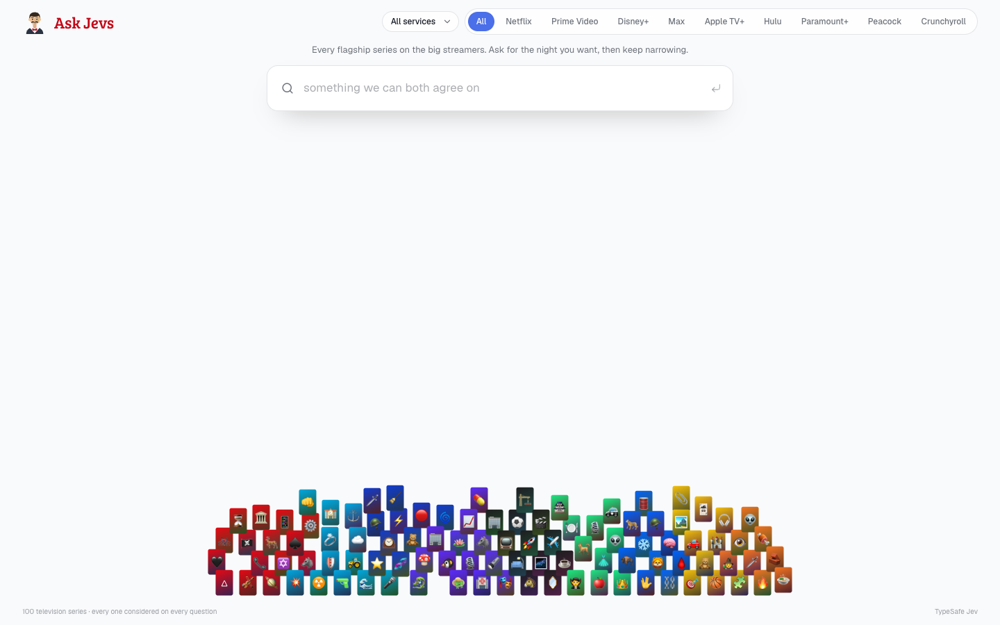
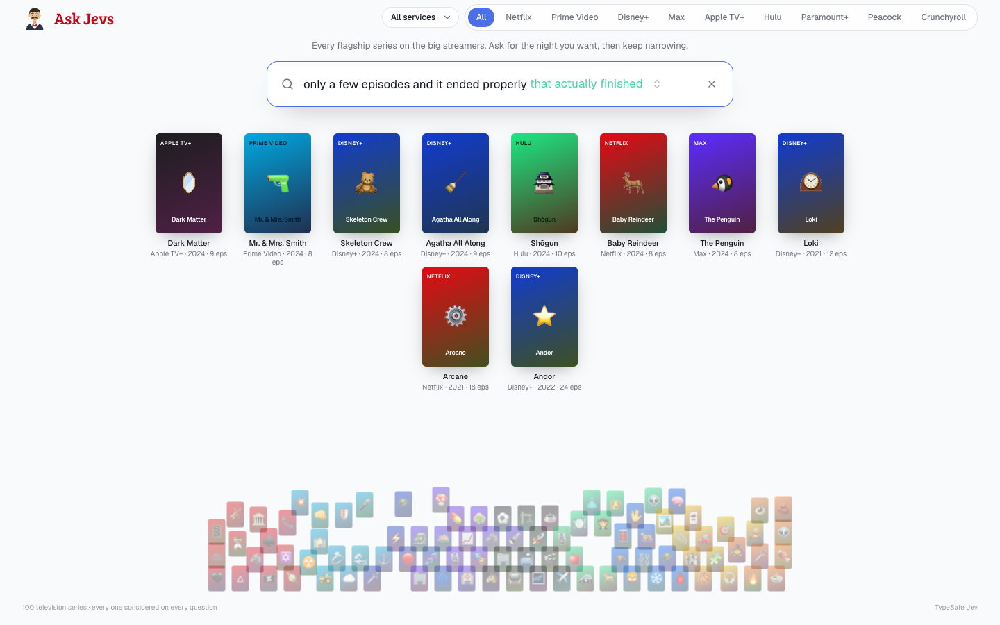

# Ask Jevs — Series

Every flagship series on the big streamers, in one pile.

Type what you actually want — *only a few episodes and it ended properly*, *funny, no plot, on in the background*, *good with my parents* — and [TypeSafe Jev](https://typesafe.ai) weighs **every title** against that sentence. The ones that fit rise out of the heap. Then keep narrowing.

A free, MIT-licensed remix of [Ask Jevs](https://ask-jev-sigma.vercel.app) for television, built by [ASV Labs](https://github.com/ASV-Labs).

<p align="center">
  
</p>

<p align="center">
  
</p>

## The catalog

A September 2026 US snapshot of originals and flagships from:

| Service | What is in the pile |
| --- | --- |
| Netflix | Stranger Things, Wednesday, Squid Game, Bridgerton, Dark, Arcane, … |
| Prime Video | The Boys, Reacher, Fallout, Clarkson’s Farm, Invincible, … |
| Disney+ | Andor, The Mandalorian, Loki, X-Men ’97, Daredevil: Born Again, … |
| Max | Succession, The Last of Us, House of the Dragon, The White Lotus, The Pitt, … |
| Apple TV+ | Severance, Ted Lasso, Slow Horses, Silo, Shrinking, … |
| Hulu | The Bear, Shōgun, Only Murders in the Building, Abbott Elementary, … |
| Paramount+ | Yellowstone, Landman, Strange New Worlds, Tulsa King, … |
| Peacock | The Office, Parks and Recreation, Poker Face, The Traitors, … |
| Crunchyroll | Frieren, Demon Slayer, Jujutsu Kaisen, One Piece, Attack on Titan, … |

Availability drifts. Treat the service tags as a demo catalog, not a live JustWatch feed.

## Run it

```bash
git clone https://github.com/ASV-Labs/ask-jev-series.git
cd ask-jev-series
npm install
cp .env.example .env.local
# optional: paste TYPESAFE_API_KEY from https://console.typesafe.ai
npm run dev
```

Open [http://127.0.0.1:3017](http://127.0.0.1:3017).

| Key | If missing |
| --- | --- |
| `TYPESAFE_API_KEY` | A local heuristic still moves the pile (`source: heuristic`) |
| `AI_GATEWAY_API_KEY` | Used when TypeSafe is unset — Jev via [Vercel AI Gateway](https://vercel.com/ai-gateway/models/jev) |

Keys stay on the server. They are never sent to the browser.

## How a question works

1. You type a sentence.
2. The server sends that sentence plus each title’s facts to Jev as parallel yes/no questions (`noul` on TypeSafe, `boolean` on the Gateway).
3. Anything at probability ≥ 0.5 rises into a grid. The rest stay in the pile, dimmed.
4. Suggested refinements (`and short`, `that actually finished`, `on Max`) append to the same question so you can keep cutting.

Jev does not write a paragraph of recommendations. It returns a number per title.

## License

[MIT](LICENSE). Free to run, fork, and ship.

Series names, artwork, and streaming-service marks belong to their owners. This project is not affiliated with TypeSafe AI, Netflix, Amazon, Disney, Warner Bros. Discovery, Apple, Hulu, Paramount, NBCUniversal, or Crunchyroll.

Inspired by the original Ask Jevs restaurant pile at [ask-jev-sigma.vercel.app](https://ask-jev-sigma.vercel.app).
